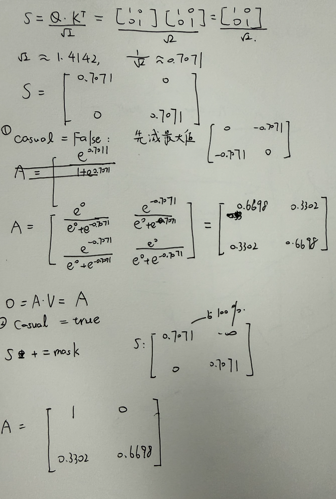

# AI6 Transformer Basic 问答

## Q1 token 和向量是什么关系？

token 是序列切分后的基本单元。计算机先用 tokenizer 把文本切成一个个小单元，每个单元就是一个 token。具体怎么切取决于分词器，不一定正好是一个单词或者一个汉字，也可能是子词、字符。

模型不能直接处理 token，要先变成向量：每个 token 先编号（token ID），再去嵌入表（embedding table，训练得到）里查出对应的 d_model 维向量。这样长度为 n 的序列就变成一个 n × d_model 的矩阵 X，每一行对应一个位置。

例（d_model = 4）：

```text
我   → ID 0 → E[0] → [ 0.2, -1.0,  0.5,  0.1]
爱   → ID 1 → E[1] → [ 0.9,  0.3, -0.2,  0.7]
学习 → ID 2 → E[2] → [-0.4,  0.8,  0.6, -0.3]
```

输入"我爱学习"，按分词结果逐个查表，就得到 3 × 4 的输入矩阵 X。

## Q2 Q、K、V 各参与哪一步？

Q、K、V 都是由同一个 X 分别乘各自的投影矩阵得到的：Q = X W_Q，K = X W_K，V = X W_V。

1. 打分：S = Q Kᵀ / √d_k，用到 Q 和 K。S[i][j] = Q[i]·K[j] / √d_k，表示第 i 个位置和第 j 个位置有多匹配。因为要做点积，Q 和 K 的维数必须一样（都是 d_k）。
2. 归一化：A = softmax(S)，逐行做，把分数变成权重，每行非负、和为 1。
3. 加权求和：O = A V，用到 V。O[i] = Σ_j A[i][j] · V[j]，就是用第 i 行的权重对 V 的各行做加权平均。V 的维数 d_v 可以和 d_k 不一样。

## Q3 softmax 应沿哪一维计算？

沿每一行算。本项目里 S 是 n × n，就是 axis=1；如果有 batch 或者多头的维度，就是最后一维。

原因是 S 的第 i 行是第 i 个 query 对所有候选 key 的打分，我们关心的是第 i 个位置的注意力怎么分给各个位置，所以要把这一行归一化成和为 1 的权重分布。如果按列做，每一列和为 1，但每一行的和就不是 1 了，O 的每一行也就不是加权平均。

实现的时候先减去每行最大值再取指数，结果不变，但可以避免 exp 溢出。

## Q4 因果掩码屏蔽什么？

模型是自回归生成的，一次生成一个 token，所以训练时不能让当前位置提前看到后面还没生成的 token。

对第 i 行，要屏蔽所有 j > i 的位置，也就是 S 的严格上三角。对角线要保留，每个位置可以看自己。

做法是在 softmax 之前把这些位置的打分 S[i][j] 设成 −∞，softmax 之后它们的权重 e^(−∞) = 0，剩下位置的权重和仍然是 1。

实验 3 验证了这一点：随机生成 4 × 3 的输入，只改最后一个位置。开掩码时前 3 个位置的输出最大变化是 0.000e+00，不开掩码时是 4.993e+00，说明开了掩码以后前面的位置确实看不到后面。

## Q5 Q=K=V 为 2×2 单位阵，d_k=2，A 和 O 是多少？

```text
S = I / √2 = [[0.707107, 0       ],
              [0,        0.707107]]
```

```text
e^0.707107 = 2.028115,  e^0 = 1,  和 = 3.028115
A[0] = [2.028115 / 3.028115, 1 / 3.028115] = [0.669762, 0.330238]
```

```text
S[0] + mask[0] = [0.707107, −∞]
A[0] = [e^0.707107, 0] / e^0.707107 = [1, 0]
```

结果（和 log.txt 里实验 1 的输出一致）：

```text
无掩码：
A = O = [[0.669762, 0.330238],
         [0.330238, 0.669762]]

因果掩码：
A = O = [[1,        0       ],
         [0.330238, 0.669762]]
```

第一行的变化：无掩码时位置 0 有 67% 的权重给自己，33% 给位置 1。开了因果掩码以后，位置 1 对位置 0 来说是未来，被屏蔽；位置 0 前面没有别的位置，只能看自己，所以 A[0] 变成 [1, 0]，O[0] = V[0]。第二行本来就不看未来，所以不变。

手算稿：


